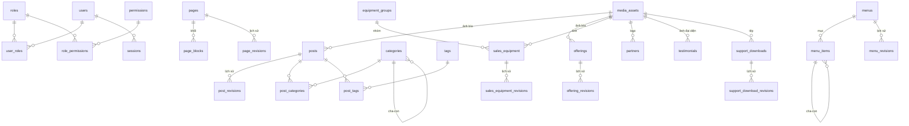

# Cơ sở dữ liệu iOrder V2

PostgreSQL 17, ORM Drizzle. Chỉ Backend được truy cập DB; CMS và website gọi API của Backend.

- **Nguồn chuẩn của cấu trúc:** `packages/core/src/db/schema/*.ts`. Khi file này và schema lệch nhau, tin schema rồi sửa file này.
- **Migration:** thư mục `drizzle/`, 15 file từ `0000_initial_schema` đến `0014_media_version`. Kiểm tra bằng `pnpm db:check`.
- **Cột JSONB:** dữ liệu luôn được kiểm tra bằng Zod ở `packages/core/src/server/**/*.contract.ts` trước khi ghi và sau khi đọc.

Phần 1–4 mô tả cấu trúc, ít thay đổi. Phần 5 là ảnh chụp dữ liệu DB local tại một thời điểm, sẽ cũ dần.

## 1. Quy ước chung

| Quy ước | Ý nghĩa |
|---|---|
| `id uuid` | Khóa chính mọi bảng (trừ bảng nối), sinh tự động. |
| `created_at`, `updated_at` | Có ở hầu hết bảng (`timestamptz`, mặc định `now()`). Các bảng bên dưới không ghi lại hai cột này. |
| `deleted_at` | **Xóa mềm**: dòng còn trong DB nhưng bị ẩn. Slug chỉ phải duy nhất giữa các dòng chưa xóa (unique index có `where deleted_at is null`). |
| `status` (`content_status`) | Vòng đời nội dung: `draft` → `review` → `scheduled` → `published` → `archived`. Hẹn giờ đã tới giờ được coi như đã xuất bản. |
| `draft_version` / `version` | Số phiên bản, tăng mỗi lần lưu. Client gửi `expectedVersion`; lệch phiên bản thì trả HTTP 409 (chặn hai người ghi đè nhau). |
| Bảng `*_revisions` | Lịch sử phiên bản: mỗi lần lưu ghi một `snapshot` JSONB đầy đủ, dùng để xem lại và khôi phục. |
| Tham chiếu tới `users` | `on delete set null`: xóa người dùng không làm mất nội dung. |
| Tham chiếu tới `media_assets` | `on delete set null`: xóa ảnh thì nội dung chỉ mất ảnh. |

### Enum

| Enum | Giá trị |
|---|---|
| `content_status` | draft, review, scheduled, published, archived |
| `post_type` | news, promotion, case_study, announcement, guide |
| `offering_type` | software, solution, service |
| `partner_kind` | partner, customer |
| `lead_status` | new, contacted, closed |
| `user_status` | active, disabled |

## 2. Sơ đồ quan hệ

`page_blocks.data` có thể chứa id media, nhưng đó là tham chiếu bên trong JSONB, không phải khóa ngoại. Thư viện media tìm chỗ đang dùng ảnh bằng cách dò chuỗi.

## 3. Các bảng

### 3.1. Tài khoản và phân quyền

**`users`**: tài khoản CMS.

| Cột | Kiểu | Ghi chú |
|---|---|---|
| username | varchar(80) | duy nhất |
| email | varchar(320) | duy nhất, có thể trống |
| password_hash | varchar(255) | không bao giờ trả ra API |
| full_name | varchar(180) | |
| status | user_status | mặc định `active` |
| last_login_at | timestamptz | |

**`roles`**: `code` (duy nhất), `name`, `description`, `is_system` (vai trò hệ thống không xóa được).

**`permissions`**: `code` (duy nhất, dạng `module.action`, ví dụ `posts.publish`), `name`, `description`. Danh sách quyền định nghĩa trong code (`packages/core/src/server/auth/permissions.ts`): 16 module, tổng 57 quyền.

| Module | Hành động |
|---|---|
| dashboard, audit | view |
| pages, posts, offerings, equipment, support_downloads, supporting | view, create, update, delete, publish |
| media, taxonomy, redirects, roles | view, create, update, delete |
| navigation, settings, leads | view, update |
| users | view, create, update |

**`user_roles`** (user_id, role_id) và **`role_permissions`** (role_id, permission_id): bảng nối, khóa chính kép, xóa theo (cascade).

**`sessions`**: phiên đăng nhập. Gồm `token_hash` (duy nhất; chỉ lưu hash, không lưu token), `expires_at`, `last_seen_at`, `revoked_at`, `ip_hash`, `user_agent`.

**`login_throttle_buckets`**: giới hạn số lần đăng nhập sai. Khóa chính (scope, key_hash), cùng `attempts` và `window_expires_at`. Dọn bằng `pnpm db:cleanup-login-throttles`.

### 3.2. Trang website

**`pages`**: mọi URL công khai là một trang. Trang hệ thống (route nằm trong code: `home`, `about`, `listing-news`, `listing-guides`…) được khai báo ở `fixedWebsitePages` (`pages.contract.ts`). Trang tự tạo hiện ở `/trang/<slug>`.

| Cột | Kiểu | Ghi chú |
|---|---|---|
| title | varchar(220) | |
| slug | varchar(180) | duy nhất giữa trang chưa xóa |
| template | varchar(80) | `default`, `homepage`, `contact`, `listing` |
| status, draft_version | | theo quy ước chung |
| seo_title / seo_description | varchar(70) / varchar(180) | |
| canonical_url | text | |
| scheduled_at, published_at, deleted_at | timestamptz | |

**`page_blocks`**: các thành phần của trang, theo thứ tự.

| Cột | Kiểu | Ghi chú |
|---|---|---|
| page_id | uuid → pages | xóa theo trang |
| type | varchar(80) | loại khối (xem bảng dưới); **không phải enum DB**, thêm loại mới không cần migration |
| sort_order | int | duy nhất trong một trang |
| data | jsonb | nội dung khối, schema theo `type` (`pageBlockInputSchema`) |
| appearance | jsonb | vỏ chung: `{ anchor, tone: auto/white/tinted/dark, spacing: auto/sm/md/lg }`; để trống = "Tự động" |
| is_enabled | bool | ẩn/hiện khối |

| `type` | Tên trong CMS | Nội dung chính trong `data` |
|---|---|---|
| hero | Phần đầu trang | eyebrow, title, description, 2 nút, layout (5 kiểu), ảnh, slides, highlights, tone |
| media_text | Ảnh + chữ | layout trái/phải, title, description, bullets, mediaId, 2 nút |
| features | Lưới thẻ | eyebrow, title, description, items[{title, description, href, icon}] |
| industries, ecosystem | (cũ) giống Lưới thẻ | như `features`; không thêm mới được |
| process | Quy trình | như Lưới thẻ, hiển thị dạng các bước |
| grouped_list | Danh sách theo nhóm | groupLabel, showCount, groups[{title, icon, items[{label, icon, href}], action}] |
| stats | Số liệu nổi bật | items[{value, label, note}] |
| collection_list | Danh sách nội dung | source (posts/guides/downloads/equipment/software/solution/service), limit, anchor |
| pricing | Bảng giá | plans[{name, price, period, features, action, highlighted, badge}] |
| testimonials, partners | Đánh giá / Logo | chỉ cấu hình số lượng, dữ liệu lấy từ bảng `testimonials`, `partners` |
| cta | Kêu gọi hành động | title, action |
| lead_form | Biểu mẫu tư vấn | title, submitLabel, needOptions |
| faq | Câu hỏi thường gặp | items[{question, answer}] |
| rich_text | Đoạn văn bản | heading, body (tài liệu soạn thảo) |
| image | Hình ảnh | mediaId, alt, caption |
| featured_posts, download_list | (cũ) | hiển thị như `collection_list` |

Mã biểu tượng (`icon`) là danh sách cố định trong `packages/core/src/server/shared/block-icons.ts`.

**`page_revisions`**: lịch sử trang. Gồm `version_number` (duy nhất theo trang), `snapshot` (toàn bộ trang kèm các khối), `editor_id`, `change_note`, `is_published`.

### 3.3. Bài viết, tin tức, hướng dẫn

**`posts`**: một bảng cho mọi loại bài. Loại `type = guide` hiện ở `/ho-tro/huong-dan/<slug>`, các loại khác ở `/tin-tuc/<slug>`.

| Cột | Kiểu | Ghi chú |
|---|---|---|
| type | post_type | |
| author_id, cover_media_id | uuid | |
| title, slug, excerpt | | slug duy nhất giữa bài chưa xóa |
| content | jsonb | tài liệu soạn thảo (`shared/rich-text`) |
| content_html | text | chỉ script nhập dữ liệu V1 ghi vào; ứng dụng không đọc (website vẽ từ `content`) |
| view_count | int | |
| promotion_start_at / promotion_end_at | timestamptz | dùng cho khuyến mãi |
| cta_label, cta_url, badge_text | | nút và nhãn tùy chọn |
| status, draft_version, SEO, scheduled_at, published_at, deleted_at | | theo quy ước chung |

**`post_revisions`**: lịch sử bài viết.

**`categories`**: chuyên mục, có cấp cha-con (`parent_id`, không xóa được cha khi còn con). Gồm `name`, `slug` (duy nhất), `description`, `sort_order`, `version`.

**`tags`**: thẻ, gồm `name`, `slug` (duy nhất), `version`.

**`post_categories`**, **`post_tags`**: bảng nối. Không xóa được chuyên mục hoặc thẻ khi còn bài đang dùng (`restrict`).

### 3.4. Sản phẩm, giải pháp, dịch vụ, thiết bị

**`offerings`**: phần mềm, giải pháp, dịch vụ (`type`). Hiện ở `/phan-mem`, `/giai-phap`, `/dich-vu`.

| Cột | Kiểu | Ghi chú |
|---|---|---|
| type | offering_type | slug duy nhất trong cùng `type` |
| summary | text | |
| content | jsonb | description, tags, bestFor, keyValue, metrics, features, benefits, faq, items, category, pricing |
| icon | varchar(120) | |
| sort_order, is_featured | | thứ tự, nổi bật |
| status, draft_version, SEO, lịch | | theo quy ước chung |

**`offering_revisions`**: lịch sử.

**`equipment_groups`**: nhóm thiết bị. Gồm `name`, `slug`, `description`, `cover_media_id`, `sort_order`, `is_enabled`, `deleted_at`, `version`.

**`sales_equipment`**: thiết bị bán (`/thiet-bi/<slug>`). Gồm `group_id` (bắt buộc), `model_code`, `price_vnd` (bigint), `warranty_months` (mặc định 12), `summary`, `specification_groups` (jsonb: `[{title, items[{label, value}]}]`), `is_featured`, cùng các cột status/SEO/lịch.

**`sales_equipment_revisions`**: lịch sử.

### 3.5. Hỗ trợ, đối tác, khách hàng

**`support_downloads`**: tệp cài đặt (`/ho-tro/cai-dat`). Gồm `file_media_id`, `icon`, `title`, `description`, `meta` (ví dụ "PDF · 1 trang"), `sort_order`, `is_enabled`, `draft_version`, `archived_at`, `deleted_at`.

**`support_download_revisions`**: lịch sử.

**`partners`**: logo đối tác/khách hàng. Gồm `kind`, `name` (duy nhất giữa dòng chưa xóa), `logo_media_id`, `description`, `website_url`, `sort_order`, `is_enabled`, `deleted_at`, `version`.

**`testimonials`**: đánh giá. Gồm `author_name`, `author_role`, `company`, `quote`, `rating` (1–5), `avatar_media_id`, `sort_order`, `is_enabled`, `deleted_at`, `version`.

**`contact_leads`**: liên hệ từ form tư vấn. Gồm `name`, `phone`, `email`, `business_model`, `branches`, `need`, `message`, `status` (lead_status), `ip_hash` (chỉ lưu hash IP), `handled_at`, `handled_by`. Bảng này có dữ liệu cá nhân, nên không in ra log.

### 3.6. Media

**`media_assets`**: tệp tải lên (lưu ở S3, DB chỉ giữ thông tin).

| Cột | Kiểu | Ghi chú |
|---|---|---|
| storage_key | varchar(500) | khóa trên S3, duy nhất |
| original_name, mime_type | | |
| file_size | bigint | byte |
| width, height | int | ảnh |
| alt_text, caption | | |
| version | int | chống ghi đè khi sửa mô tả |
| uploaded_by, deleted_at | | tệp đã xóa mềm được dọn bằng `pnpm db:cleanup-media` |

### 3.7. Menu, cấu hình, hệ thống

**`menus`**: mỗi vị trí một menu: `location` (duy nhất: `header`, `header_cta`, `footer`), `name`, `version`.

**`menu_items`**: các mục menu.

| Cột | Ghi chú |
|---|---|
| menu_id, parent_id | cây menu (mục con xóa theo mục cha) |
| label, url, target (`_self`/`_blank`), icon | |
| link_type, content_id | `custom` hoặc liên kết tới nội dung (`page`, `post`, `offering`, `equipment`): đổi slug nội dung thì menu tự theo |
| sort_order, is_enabled | |

**`menu_revisions`**: lịch sử menu.

**`site_profile`**: thông tin doanh nghiệp (một dòng, `profile_key = default`). Gồm `company_name`, `legal_name`, `hotline`, `support_email`, `sales_email`, `address`, `working_hours`, `logo_media_id`, `version`.

**`site_settings`**: cấu hình dạng khóa → JSONB.

| `key` | Nội dung |
|---|---|
| `publishing` | siteUrl, defaultTitle, defaultDescription, defaultOgMediaId, allowSearchIndexing |
| `external_links` | appLogin, trial, facebook, zalo, youtube, appStore, googlePlay |
| `listing_content` | (cũ) tiêu đề trang danh sách news/support/equipment/guides; nay dùng trang `listing-*` trong `pages` |
| `catalog_content` | (cũ) tiêu đề trang danh sách software/solution/service; nay dùng trang `listing-*` |

**`redirects`**: chuyển hướng URL. Gồm `source_path` (duy nhất giữa dòng chưa xóa), `destination_path`, `status_code` (mặc định 301), `is_enabled`, `deleted_at`, `version`. Đổi slug nội dung đang hiển thị thì hệ thống tự thêm chuyển hướng.

**`audit_logs`**: nhật ký thao tác. Gồm `user_id`, `action` (ví dụ `page.update`), `entity_type`, `entity_id`, `before_data`/`after_data` (jsonb), `ip_hash`, `ip_address`, `user_agent`, `request_id`. Ba cột cuối lấy tự động từ request; script/seed để trống.

## 4. Lệnh thường dùng

| Lệnh | Việc |
|---|---|
| `pnpm db:generate` | Sinh migration từ thay đổi schema |
| `pnpm db:migrate` | Chạy migration |
| `pnpm db:check` | Kiểm tra migration khớp schema |
| `pnpm db:studio` | Mở Drizzle Studio để xem dữ liệu |
| `pnpm db:backfill-listing-pages` | Tạo trang danh sách hệ thống còn thiếu (chạy lại an toàn) |
| `pnpm db:split-support-guides` | Tách Hướng dẫn sử dụng khỏi Hỗ trợ cài đặt (chạy lại an toàn) |

Không chạy seed/import phá hủy trên DB đang có dữ liệu thật.

## 5. Ảnh chụp DB local, 22/10/2026

Lấy bằng truy vấn chỉ đọc (transaction `read only`), không in dữ liệu cá nhân. PostgreSQL 17.11, dung lượng 17 MB, đã chạy 15/15 migration.

### Số dòng

| Nhóm | Bảng (số dòng) |
|---|---|
| Tài khoản | users 5 · roles 8 · permissions 57 · user_roles 5 · role_permissions 259 · sessions 1.886 · login_throttle_buckets 0 |
| Trang | pages 60 (15 đang dùng, 45 đã xóa mềm) · page_blocks 99 · page_revisions 338 |
| Bài viết | posts 8 · post_revisions 8 · categories 5 · tags 7 · post_categories 8 · post_tags 14 |
| Sản phẩm | offerings 13 (4 đã xóa mềm) · offering_revisions 27 |
| Thiết bị | equipment_groups 6 (3 đã xóa) · sales_equipment 8 (3 đã xóa) · sales_equipment_revisions 11 |
| Hỗ trợ | support_downloads 3 · support_download_revisions 3 |
| Đối tác | partners 17 · testimonials 3 · contact_leads 0 |
| Media | media_assets 70 (28 đã xóa mềm; còn 39 ảnh ≈ 19,3 MB và 3 tệp tài liệu) |
| Menu và cấu hình | menus 3 · menu_items 34 · menu_revisions 17 · site_profile 1 · site_settings 4 · redirects 0 |
| Nhật ký | audit_logs 4.543 |

### Nội dung đang có

- **Bài viết** (đều đã xuất bản): 2 tin tức, 1 khuyến mãi, 1 câu chuyện khách hàng, 1 thông báo, 3 hướng dẫn.
- **Sản phẩm**: phần mềm 3 xuất bản + 1 nháp; giải pháp 3; dịch vụ 2.
- **Thiết bị**: 5 xuất bản.
- **Menu**: header 17 mục, footer 15 mục, header_cta 2 mục.
- **Vai trò**: admin (hệ thống, 57 quyền, 1 người), content_manager (47), editor (33, 1 người), marketing (28, 1 người), publisher (19), analyst (14), support (4, 1 người), `role_ba1d1a363a14` (57 quyền, 1 người).

### 15 trang đang dùng

| Slug | Template | Trạng thái | Phiên bản | Các khối |
|---|---|---|---|---|
| home | homepage | published | 54 | hero, partners, ecosystem, collection_list, media_text, industries, process, image |
| about | default | published | 5 | hero, stats, media_text, partners, cta |
| contact | contact | published | 5 | hero, lead_form, faq |
| listing-news | listing | published | 126 | hero, collection_list |
| listing-equipment | listing | published | 13 | hero, collection_list |
| listing-support | listing | published | 6 | hero, collection_list |
| listing-guides | listing | published | 1 | hero, collection_list |
| listing-software / -solution / -service | listing | published | 5 | hero, collection_list |
| privacy-policy, terms | default | published | 5 | hero, rich_text |
| remote-support | default | published | 5 | hero, process |
| support-faq, support-videos | default | archived | 4 | hero, features |

Có 99 khối, trong đó 58 là `hero`. Số khối `hero` nhiều hơn số trang đang dùng vì còn khối của các trang đã xóa mềm. Chưa khối nào dùng cột `appearance`, tức tất cả đang để "Tự động".

### Điểm cần chú ý

1. **45 trang đã xóa mềm** vẫn nằm trong `pages`, `page_blocks` và `page_revisions`, có thể là trang tạo khi chạy kiểm thử. Chúng không hiện ra ngoài; muốn dọn thì cần một lệnh xóa hẳn riêng.
2. **`sessions` có 1.886 dòng** và chưa có lệnh dọn phiên hết hạn (mới chỉ có lệnh dọn `login_throttle_buckets`).
3. **Vai trò `role_ba1d1a363a14`** có mã tự sinh, đủ 57 quyền, đang gán cho 1 người dùng. Nên kiểm tra lại xem có phải vai trò tạo khi kiểm thử không.
4. **`site_settings.listing_content` và `catalog_content`** chỉ còn là dự phòng cũ; trang danh sách nay lấy từ `pages`.
5. **Khối cũ** `industries` và `ecosystem` (1 khối mỗi loại, đều ở trang chủ) vẫn hiển thị bình thường, có thể chuyển sang "Lưới thẻ" trong CMS.
6. `external_links` đã lưu 320 lần, cao bất thường so với các cấu hình khác; khả năng do kiểm thử tự động.
7. Hai cột chưa được ứng dụng dùng: `posts.content_html` (chỉ dữ liệu nhập từ V1) và `menu_items.icon`.
